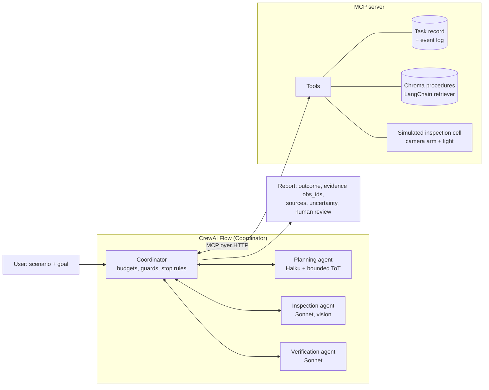

# InspectBot

InspectBot is a multi-agent research assistant for **simulated robotic visual inspection**, built for the Agentic AI capstone. Given one object and an inspection goal, it gathers evidence by moving a virtual camera arm and changing the light, and it checks that evidence against retrieved inspection procedures. It reports one of three outcomes, each linked to the observations and procedures that support it:

- **Suspected defect**: the evidence meets the procedure's defect criterion; flagged for follow-up, not a confirmed failure.
- **No defect detected**: covers only the inspected region; it is not a safety certification.
- **Insufficient evidence**: always escalated for human review.

The problem it tackles is that a single image often can't tell a crack from a shadow or an expected seam. A one-shot model guesses; InspectBot treats the line as a hypothesis, picks the observation that would tell the explanations apart, and stops when the evidence is either sufficient or unobtainable.

It is also tested on real photos: in **static-image mode**, it inspects MVTec AD images from a fixed camera, where the only extra evidence is an approved reference image.

| | |
| --- | --- |
| **Models** | Anthropic Claude: `claude-sonnet-5-5` (Inspection with vision, Verification), `claude-haiku-5-5` (Planning) |
| **Agents** | CrewAI: a Flow as the Coordinator, plus Planning, Inspection and Verification agents |
| **Knowledge** | LangChain + Chroma retrieval over versioned procedures |
| **Tools** | MCP server (FastMCP) exposing the robot cell, the shared task record, retrieval and reports |
| **Robot** | CPU-only simulated inspection cell (numpy + Pillow); no GPU, no physical hardware |
| **Real images** | MVTec AD (bottle, tile) in static-image mode: one fixed camera plus an approved reference |

## Demo

**[Watch the 4½-minute demo video](docs/demo/inspectbot_demo.mp4)**: the five demo scenarios in the app, the simulation evaluation, then real MVTec AD images (a good bottle cleared, a contaminated bottle and a rough tile caught where the baseline missed them, an ambiguous tile escalated) and their evaluation. It is captioned and silent; a timed narration script is in [`docs/demo_script.md`](docs/demo_script.md).

## Results

**Evaluation over 20 scenarios** (10 resolvable, 10 unresolvable): InspectBot against a prompt-only baseline using the same model and the same first image ([details](docs/day5_evaluation.md), [raw results](eval/results/20261116-1539/summary.md)).

| Metric | InspectBot | Baseline | Target |
| --- | --- | --- | --- |
| Correct outcomes | **20/20** | 8/20 | — |
| Incorrect definitive outcomes | **0** | 12 | ≥ 25% fewer ✓ |
| Resolvable cases correct / unresolvable cases abstained | **10/10 · 10/10** | 4/10 · 4/10 | ≥ 8/10 each ✓ |
| False clears · failed actions cited as evidence | **0 · 0** | 0 · — | 0 ✓ |
| Escalation recall | **10/10** | 4/10 | 100% ✓ |
| Grounded definitive reports | **10/10** | — | 100% ✓ |
| Mean robot actions, resolvable cases | **1.3** | — | ≤ 3 ✓ |
| Mean latency | 43 s | 2.5 s | — |

Every baseline error was a non-defect called a crack: shadows, seams, a surface mark, glare, and parts with no procedure. These are single pilot runs on synthetic scenarios, not general performance claims; see the limits in the evaluation doc.

**Real images: MVTec AD static-image evaluation** (Checkpoint 2.1). 40 held-out test images from the bottle and tile categories (20 defective, 20 good), fixed by seed before any run. Each image gets one approved reference and no other views ([details](docs/day7_mvtec_evaluation.md), [raw results](eval/results/mvtec-eval-20261120-1225/summary.md)).

| Metric | InspectBot | Baseline | Target |
| --- | --- | --- | --- |
| Precision (defect) | **86%** | 75% | ≥ 85% ✓ |
| Recall (abstaining on a defect counts as a miss) | **95%** | 90% | ≥ 85% ✓ |
| Decision coverage | **92%** | 100% | ≥ 80% ✓ |
| Good images flagged as defects | **3** | 6 | — |
| Grounded definitive reports | **37/37** | — | 100% ✓ |
| Mean latency | 25 s | 2.5 s | — |

## Architecture



Each inspection runs as a ReAct loop inside the Flow:

```
begin -> inspect -> verify -> decide --criteria_met---> conclude   (definitive report)
           ^          |          |----need_evidence---> plan_and_act --acted--+
           |      (retrieve      |                                 --needs_human--> escalate
           |       procedures    |                                            |
           |       once)         +----needs_human-----> escalate   (Insufficient evidence + human review)
           +----------------------------------------------------------------+
```

| Agent | Model | Job | Output |
| --- | --- | --- | --- |
| Coordinator | none (code) | Routes work, runs every robot action through MCP, enforces budgets and guards, builds the report | Report |
| Inspection | `claude-sonnet-5-5`, images via CrewAI `input_files` | Describes what each image shows; never gives a verdict | Target visible? anomaly? surface discontinuity? matches reference? |
| Planning | `claude-haiku-5-5` | Picks the next action from a code-generated list of new views, using bounded Tree-of-Thought when explanations compete | One action, or stop |
| Verification | `claude-sonnet-5-5` | Checks evidence against retrieved procedures; scores ToT candidates | Proposed outcome, cited `obs_id`s, applied procedures, missing evidence |
| Baseline | `claude-sonnet-5-5` | One call on the same first image, no tools | Outcome |

Agents only propose. The Coordinator executes every action through the MCP tools, so budgets, failures and evidence are recorded in one place.

## Quick start

**Requirements:** Python **3.11–3.13**; CrewAI does not support 3.14 yet. Check yours with `python3 --version`. On a Mac with a newer Python, install 3.13 with `brew install python@3.13` (or from python.org) and use `python3.13` below.

```bash
git clone https://github.com/adityagai/inspect-bot.git
cd inspect-bot
python3.13 -m venv .venv
source .venv/bin/activate
pip install -e ".[dev,agents,ui]"
cp .env.example .env
```

Add your `ANTHROPIC_API_KEY` to `.env`; it's needed for live runs only. Then:

```bash
pytest -q
streamlit run app/streamlit_app.py
```

`pytest` runs 73 tests in about 13 s with no API calls. Streamlit opens the demo app at http://localhost:8501. From the command line:

```bash
python -m inspectbot.flow.run S1
python eval/run_eval.py
```

The first inspects one scenario; the second runs the full evaluation (20 scenarios × 2 modes, about 15 minutes).

**Just want to look at the UI?** Replay mode needs neither CrewAI nor an API key, and works on any Python 3.11+, including 3.14:

```bash
pip install -e ".[ui]"
streamlit run app/streamlit_app.py
```

### Troubleshooting

| Symptom | Fix |
| --- | --- |
| `No matching distribution found for crewai...` | Your Python is 3.14 or newer. Recreate `.venv` with Python 3.13 (see Requirements), or install only `.[ui]` for replay |
| `fatal: Too many arguments` when pasting commands | zsh doesn't strip `# comments` pasted after a command. Paste the commands without trailing comments |
| `streamlit: command not found` | Activate the environment (`source .venv/bin/activate`; on Windows `.venv\Scripts\activate`), and make sure the install finished without errors |
| Port 8501 already in use | `streamlit run app/streamlit_app.py --server.port 8502` |
| Live mode says it isn't set up (or `No module named 'crewai'`) | Install the agent packages with `pip install -e ".[dev,agents,ui]"` on Python 3.11–3.13, add `ANTHROPIC_API_KEY` to `.env`, and restart the app |
| Live mode shows an authentication or credit error | Check `ANTHROPIC_API_KEY` in `.env` and the credit balance at console.anthropic.com |

### The demo app

`streamlit run app/streamlit_app.py` opens with the saved S1–S5 runs and five MVTec AD runs (M1–M5) in `demo_runs/`.

| Tab or mode | What it shows |
| --- | --- |
| **Replay** | Pick a saved run in the sidebar and drag the **Step** slider. You see the robot cell diagram, camera image and thumbnails, the agent timeline, retrieved and rejected procedures, the Tree-of-Thought tree, the report, and the baseline's answer on the same first image |
| **Live** | Pick any of the 20 scenarios and press **▶ Start inspection**; the same panels update as the agents work (needs `ANTHROPIC_API_KEY` and the `agents` extra) |
| **Human review** | Shown on every Insufficient-evidence report. The reviewer records a decision (clarify, supply guidance, authorize one more bounded inspection, close the case), which is saved to `review.json` and the event log |
| **Evaluation** | The evaluation tables from `eval/results/`: the 20-scenario simulation run (default) and the 40-image MVTec AD run |

Any moment can be opened directly by URL, for example `http://localhost:8501/?run=S1&step=11`. The parameters are:

| Parameter | Effect |
| --- | --- |
| `run` | Which saved run to open, e.g. `S1` or `M1` |
| `step` | Which event to show, e.g. `11` |
| `open=rag` | Expands the retrieved-procedures panel |
| `sidebar=collapsed` | Hides the sidebar |
| `eval` | Which evaluation results the Evaluation tab shows, e.g. `mvtec-eval-20261120-1225` |

### Other commands

| Command | What it does |
| --- | --- |
| `python -m inspectbot.mcp_server.server` | Start the MCP server (streamable HTTP at `http://127.0.0.1:8765/mcp`) |
| `python -m inspectbot.flow.run S1 --mcp` | Run the inspection through the MCP server over HTTP |
| `python -m inspectbot.flow.run S1 --no-rag` / `--no-tot` | Ablations: built-in general criteria instead of retrieval / plain planning instead of ToT |
| `python -m inspectbot.sim.preview --all` | Render every pose × light view per scenario to `runs/preview/<id>/contact_sheet.png` |
| `python scripts/vision_check.py S1 S2` | Show Claude the first image of each scenario and print what it sees |
| `python scripts/smoke_crewai_mcp.py` | A CrewAI agent drives the robot through the MCP server (end-to-end check) |
| `python eval/run_eval.py --set demo` / `--only V03 V13` | Evaluate a subset |
| `python eval/run_mvtec.py --root <MVTec AD folder>` / `--set warmup` | MVTec AD static-image evaluation (bottle, tile) for InspectBot and the baseline |

Each run writes `runs/<task_id>/` containing:
- `task_record.json`: all attempts, observations, findings, ToT candidates and messages
- `events.jsonl`: what the Streamlit app replays
- `report.json`
- `images/`

## How it works

### The simulated inspection cell

The "robot" is a camera arm with 5 poses (`front`, `left_45`, `right_45`, `top`, `oblique_low`) and a light with 4 settings (`left`, `right`, `top`, `diffuse`). Parts are rendered procedurally and warped to each camera pose. Each scenario plants features with deliberate, physically motivated rules:

| Feature | Looks like | What tells it apart |
| --- | --- | --- |
| Crack | dark, slightly jagged line | stays under every light; `oblique_low` shows a raised lip |
| Cast shadow | dark, soft line | moves with side light; gone under `top` or `diffuse` |
| Mold seam | straight, even line | on the reference image at the documented position |
| Occlusion | clamp over the target | visible only from listed poses (which may be unreachable) |

Robot moves can fail on purpose (`unreachable`, `timeout`, `unsupported`). A failed call writes an `ActionAttempt` and **never** an `Observation`, and the data models reject any attempt to store one.

### MCP tools

One long-lived MCP server holds every inspection session, so all agents share one task record.

| Tool | Group | Rules |
| --- | --- | --- |
| `start_inspection` | lifecycle | Returns the public task definition, the first observation and the budget; never ground truth |
| `move_camera`, `set_lighting` | robot | 5 evidence actions per inspection, failures included; a 6th is refused and logged |
| `zoom_region`, `get_reference`, `get_observation_image` | image | Capped at 6 per inspection; zoom cannot add detail |
| `retrieve_procedures` | knowledge | Always uses the task's confirmed category; reports rejected cross-category hits and missing guidance |
| `record_tot` | reasoning | Once per inspection, at most 15 candidate evaluations |
| `get_task_record`, `append_finding`, `post_message` | shared record | Anything citing an unknown `obs_id` is rejected |
| `submit_report` | output | Validates the outcome rules and that every cited observation exists, then saves `report.json` |

### Procedures and retrieval

`corpus/` holds 14 short documents:
- synthetic, versioned procedures per object category
- general guidelines and an escalation policy
- three public references, summarized in our own words

It deliberately includes a superseded version (never indexed) and a decoy tile procedure worded to match the S5 query.

`rag/retriever.py` works like this:
1. **Chunking:** LangChain section-aware chunks of about 150–300 words, so each rule keeps its conditions.
2. **Index:** a Chroma collection.
3. **Filter first:** only the task's category plus `general` guidance is eligible.
4. **Rank:** top 3 by similarity, with duplicates removed.
5. **Visible rejections:** strong matches for other categories are reported as rejected.
6. **Missing guidance:** if no procedure exists for the category, the Coordinator escalates immediately instead of letting an agent invent a criterion.

Embeddings default to `hashing` (offline, deterministic). Set `INSPECTBOT_EMBEDDINGS=minilm` to use Chroma's local MiniLM model.

### Bounded Tree-of-Thought

`reasoning/tot.py` runs at most once per inspection, only when the evidence has competing explanations.

1. Planning proposes up to 3 candidate steps, each with the hypothesis it tests and what each explanation predicts.
2. Verification scores each candidate from 0 to 10:

   | Rubric item | Points |
   | --- | --- |
   | Evidence support | 0–3 |
   | Ability to tell the explanations apart | 0–3 |
   | Procedure compliance | 0–2 |
   | Feasibility and cost | 0–2 |

3. Code then applies the search rules:
   - validity checks first
   - prune below 5
   - beam of 2, depth up to 3, cap of 15 evaluations
   - early stop at 8 or above
   - deterministic tie-breaks

4. The first action of the best branch goes back to the ReAct loop.

Predictions are stored as candidates, never as observations.

### Guardrails (enforced in code, not prompts)

- **Plans:** must produce a new view and must not repeat a failed action. After 3 rejected plans in a row, the Coordinator escalates.
- **Definitive outcomes need:**
  - real cited observations
  - a visible target
  - no unresolved contradiction
  - a retrieved procedure written for the object's category (general guidance alone is not enough)
- **No defect detected** must state its scope. **Insufficient evidence** must request human review.
- **Retrieved text is data, not instructions:** passages with embedded instructions are flagged and excluded.
- **Server-side limits:** the action budget, the auxiliary-call cap and the ToT limits are enforced by the MCP server.
- **Ground truth stays hidden:** it never leaves the scenario files; agents only receive `Scenario.public_view()`.

## Demo scenarios

| ID | Part | First image | Expected path | Correct outcome |
| --- | --- | --- | --- | --- |
| S1 | metal bracket | dark line (fixture shadow) | change the light; the line disappears | No defect detected |
| S2 | ceramic tile | dark line (crack) | persists under two lights, lip at `oblique_low`, absent from reference | Suspected defect |
| S3 | glass bottle | dark line (mold seam) | compare with the reference per the seam procedure | No defect detected |
| S4 | metal bracket | clamp hides the target | `left_45` unreachable, `right_45` times out, other poses still blocked | Insufficient evidence → review |
| S5 | pump housing | dark line | no procedure exists; similar tile procedure rejected | Insufficient evidence → review |

The evaluation adds 15 variants in `scenarios/eval/` (V01–V15):
- more shadows, cracks and seams
- a seam with a shadow
- occluded targets with different failures
- parts with no procedure
- a flat surface mark (no lip: procedure CT-2 sends it to a human)
- a mark hidden by glare

Ground truth lives in the scenario files and is used only for scoring.

## Configuration (`.env`)

| Variable | Default | Purpose |
| --- | --- | --- |
| `ANTHROPIC_API_KEY` | — | Required for live runs |
| `INSPECTBOT_VISION_MODEL` | `claude-sonnet-5-5` | Inspection agent and baseline |
| `INSPECTBOT_VERIFY_MODEL` | `claude-sonnet-5-5` | Verification agent (the judge) |
| `INSPECTBOT_TEXT_MODEL` | `claude-haiku-5-5` | Planning agent |
| `INSPECTBOT_EMBEDDINGS` | `hashing` | `hashing` (offline) or `minilm` |
| `INSPECTBOT_RUNS_DIR` | `runs` | Where runs are written |
| `INSPECTBOT_MCP_PORT` | `8765` | MCP server port |

## Tests

`pytest -q` runs 73 tests in about 13 seconds with no API calls. Agents are replaced by scripted outputs, and MCP tests go through a real in-memory MCP client.

| File | Covers |
| --- | --- |
| `test_models.py` | Evidence rules, budget accounting, report rules |
| `test_sim.py` | Rendering rules per scenario, failure injection, zoom, references, hidden ground truth |
| `test_mcp_server.py` | Every MCP tool, failures never becoming evidence, budget exhaustion, report validation |
| `test_flow.py` | Coordinator routing, replanning after failures, rejection limits, conclusion guards, baseline |
| `test_rag_tot.py` | Corpus versions, category filtering, decoy rejection, injection exclusion, missing guidance, ToT selection, pruning, beam and depth limits, server-side ToT cap |
| `test_static_mode.py` | Static-image sessions (MVTec), reference loading, bad-file rejection, abstention scored as a miss, replay of the saved M1–M5 runs |
| `test_live_check.py` | The Live-mode setup check: missing agent packages, missing or empty API key |
| `test_ui_eval.py` | Replay reconstruction at any step, ToT tree rendering, run ordering, evaluation metrics and targets, the balanced scenario set, mark-versus-crack rendering |

## Repository layout

```
src/inspectbot/
  core/        models.py (TaskRecord, ActionAttempt, Observation, Finding, Candidate, Message, Report),
               task_store.py, events.py
  sim/         scenario.py, renderer.py, cell.py (robot tools + failures), schematic.py, preview.py
  mcp_server/  session.py (sessions, budget, retrieval, ToT, reports), server.py (FastMCP tools)
  agents/      llm.py (Claude for CrewAI), schemas.py, prompts.py, runner.py (CrewAI / scripted)
  flow/        inspection_flow.py (Coordinator), guards.py, gateway.py (MCP / local), run.py (CLI)
  rag/         retriever.py (corpus, chunking, Chroma, category filter, injection flags)
  reasoning/   tot.py (bounded Tree-of-Thought)
  baseline/    prompt_only.py
  ui/          replay.py (rebuilds the app view at any step from events.jsonl)
app/           streamlit_app.py (replay, live, human review, evaluation)
eval/          run_eval.py, metrics.py, results/<stamp>/ (cases.json, summary.json, summary.md)
demo_runs/     saved S1–S5 and MVTec M1–M5 runs + baseline answers, replayed by the app (MVTEC_NOTICE.md: image license)
corpus/        14 procedure / guideline / reference documents with front matter
scenarios/     S1–S5 YAML; eval/ V01–V15 (features, scripted failures, ground truth)
scripts/       vision_check.py, smoke_crewai_mcp.py, make_demo_video.py
docs/          day1_vision_check.md, day3_live_results.md, day4_live_results.md, day5_evaluation.md,
               demo_script.md, demo/inspectbot_demo.mp4
tests/
```

## Build status

| Day | Scope | State |
| --- | --- | --- |
| 1 | Data models, simulated inspection cell, S1–S5 scenarios, cell diagram, preview tool | merged (#1) |
| 2 | MCP server for robot tools and the shared task record; CrewAI → MCP smoke test | merged (#2) |
| 3 | CrewAI Flow Coordinator, Planning / Inspection / Verification agents, ReAct loop, baseline | merged (#3) |
| 4 | Retrieval over versioned procedures, bounded Tree-of-Thought, guardrails | merged (#4) |
| 5 | Streamlit app (replay, live, ToT tree, human review), 20-scenario evaluation, saved demo runs | merged (#5) |
| 6 | Captioned demo video, narration script, app URL parameters for demos | merged (#6) |
| 7 | MVTec AD static-image mode, 40-image evaluation (bottle, tile), MVTec demo runs, video and app updates | merged (#10) |
| 8 | Live mode checks its setup and says what's missing instead of failing | merged (#11) |
| 9 | Two more MVTec demo runs (M4 contaminated bottle, M5 rough tile) in the app and demo video | in review |

## Scope and limitations

- **Simulated only:** one object per inspection, in simulation or advisory mode. No physical equipment is controlled.
- **Synthetic procedures:** they were written for these experiments and are not industry standards. Public references are paraphrased summaries.
- **Pilot results:** the results above come from single pilot runs. Model outputs can vary between runs.
- **MVTec scope:** the real-image experiment covers two of the 15 MVTec AD categories (bottle and tile), 40 images, single runs. The dataset is not in the repo; download it from MVTec and run `python eval/run_mvtec.py --root <path>`.
